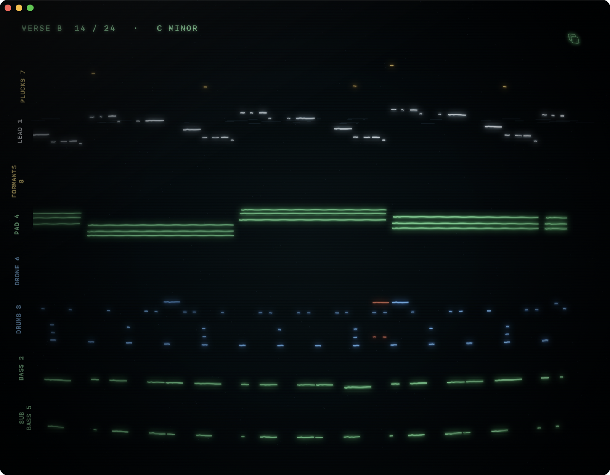

# Middy

**Power on. Patch in. Roll the dice.**

Middy is a live MIDI sequencer for macOS with a glowing CRT and a soft spot for acid bass. It writes eight parts in 4/4 as it plays, locked to Ableton Live over Link. Watch the notes scroll by, ride the drop, or hit the dice for a fresh arrangement.



[Build Middy](#build-and-open) · [Grab the Live Set](ableton/Middy.als) · [Connect to Live](#connect-to-live)

## Build and open

Requires macOS 14 or newer, the Xcode command-line tools with Swift 6, CMake, and Git. The first build fetches Ableton Link 4.1.1 and its pinned Asio dependency.

```sh
./scripts/build
open .build/Middy.app
swift test
```

## Included Ableton Live Set

Open [Middy.als](ableton/Middy.als) in Live after launching Middy, then enable **Link** and the **Middy** MIDI input. The set already assigns the eight MIDI channels. The Plucks and Sub Bass tracks use **All Ins** on channels 7 and 5. Set them to **Middy** if you want to isolate those tracks from other controllers.

The set was saved in Live 12.4.16 Suite. It references the **Build and Drop** and **Stray Cats Collection by Max for Cats** Packs, a **Serum 2** factory ride sample, and **Kickstart 2** (VST). Have those installed or swap the missing sounds and plug-ins for your own.

## Connect to Live

1. Enable **Link** in Live. Allow Middy to access the local network if macOS prompts you.
2. In Live's **Link, Tempo & MIDI** settings, enable **Track** for the **Middy** MIDI input.
3. Add up to eight MIDI tracks. Set **MIDI From** to **Middy**, choose the channel below, and set monitoring to **In** for playback.
4. Open Middy once the tracks are routed. Set Live's Global Quantization to **1 Bar** for matching four-beat launch boundaries.

| MIDI channel | Part | Set up in Live |
| --- | --- | --- |
| 1 | Lead | Load a lead synth |
| 2 | Bass | Load an acid bass synth |
| 3 | Drums | Load a Drum Rack with the pads below |
| 4 | Pad | Load a polyphonic synth |
| 5 | Sub bass | Load a sub synth |
| 6 | Environmental drone | Load a slow, sustained polyphonic instrument |
| 7 | Plucks | Load a bright synth for short octave-up lead accents |
| 8 | Formants | Load the robot-formant instrument |

Set the Drum Rack’s **Receive** notes to match these pads.

| Sound | Live note | MIDI note |
| --- | --- | ---: |
| Kick | C1 | 36 |
| Clap | D♯1 | 39 |
| Snare | D1 | 38 |
| Closed hat | F♯1 | 42 |
| Cymbal | C♯2 | 49 |
| Tambourine | F♯2 | 54 |
| Shaker | A♯4 | 82 |

## Under the hood

- **Arrangement.** The conductor moves through Intro → Build (A) → Verse (B) → Breakdown (C/D/E) → Build (A) → Verse (B) → Outro. Verses last 24 bars, the breakdown lasts 64, and builds and transitions last 4. Eight-bar changes shape the supporting parts while the lead and bass patterns continue. Selected pads shift at the eight-bar boundaries. The breakdown cycles through eight eight-bar phrases, revisiting three melodic and harmonic variations. The opening drone gives way to soft percussion, with later blocks leaving space in the drums and pads. When present, breakdown hats keep the same two offbeats per bar, then play all four offbeats for the final four bars. The outro doubles as the next song’s intro. Both transitions preview the incoming song’s lead motif at gentle velocity and play short excerpts from its verse harmony.
- **Melody and harmony.** Each song changes its minor-key harmonic plan, chord voicing, and two motif contours. A, C, and E share one motif with their own pitch progressions, while B and D use the other motif. Motifs can step or leap a diatonic third. Verses and breakdowns repeat an eight-bar chord progression and melodic call and answer. A shared stress pattern shapes the bass rhythm and the lead and bass accents. Lead phrases leave rests between motif fragments and mix short passing notes with longer accents. The lead follows the same per-song kick or offbeat emphasis as the sub bass. The parts vary velocity and gate length, with subtle timing variation on melodic notes and percussion. The app starts in C minor and moves to a neighboring minor key with six shared scale tones at each song change.
- **Drums and bass.** Drum patterns repeat in four-bar phrases with section-specific cymbal entrances and fills. Shaker and tambourine appear only on selected build and verse bars. The kick stays on the beat. The main bass leaves space between attacks and occasionally plays a late-bar fifth or lower minor-seventh pickup. The sub bass follows every bass attack while staying on the root one octave below the main bass’s root. Each song picks kick or offbeat accents for the sub. Those notes are louder and ring longer. Verse hats open up in the middle eight bars, then thin alongside the Plucks. Each song gives Plucks a role on the beat, on the upbeat, or on syncopated sixteenths. Each role shapes a repeating four-bar rhythm with an opening accent, a bar of rest, and a late ending accent. Plucks double higher or more stressed lead notes within those rhythmic slots and leave out the extra accents in the last eight bars of each verse.
- **Pads and texture.** The optional pad plays gently staggered triads, quieter in breakdowns and stronger in returning verses. Some four-bar verse phrases shorten the pad chords to half or a quarter of their usual length. In selected breakdown phrases, a chord that repeats can ring across two bars. A song can leave either verse or the entire breakdown without pads. Formants give short two-note replies near phrase endings in selected verses, favoring verses without pads. The environmental drone holds three-note chords for four bars in transitions and the first eight bars of a breakdown. It occasionally enters the returning verse.
- **Build and drop.** The last two bars of each build introduce the verse melody. Bass and sub bass enter together on the verse downbeat. Builds come in three intensities, and the two builds in a song use different intensities. Drum velocity and optional pad swells follow the build’s intensity. Gentle builds use a short fill, rising builds accelerate to sixteenths before a half-beat pre-drop, and peak builds reach thirty-seconds before a full-beat pre-drop. Both rolls leave a quiet pickup on the verse’s opening pitch.
- **CRT.** The traces show pitch by height, note length across the screen, and velocity by thickness. The readout shows the current key, phrase, and bar count.

The desktop Ableton Link library is available under [GPLv2+ or a proprietary license](https://github.com/Ableton/link/tree/Link-4.1.1#license).
